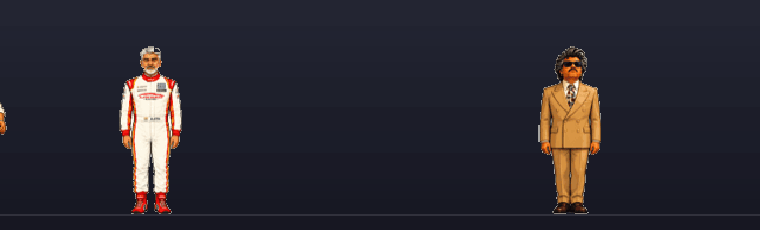
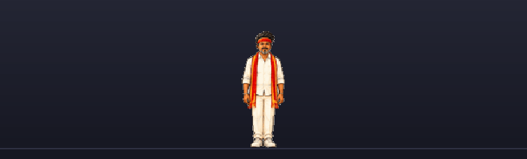

# Superstar Deskmates

[](https://github.com/Dhodraj/superstar-deskmates/actions/workflows/ci.yml)

Pixel film stars that live on your Mac desktop and do one small job each.



No account. No network. No permission prompts. Nothing leaves the Mac.

```
git clone git@github.com:Dhodraj/superstar-deskmates.git
cd superstar-deskmates
./scripts/make_app.sh && open build/Deskmates.app
```

Needs macOS 14 or later and the Xcode Command Line Tools.

## Who is on your desk

| | Job | What you see |
|---|---|---|
| **Vijay** | Focus timer | Click him and he folds his arms for the session, with the countdown over his head. Leave the app you started in and he notices. He waves when you are done |
| **Ajit** | Battery | Helmet on while the Mac charges, hands up when the charge runs low |
| **Rajni** | What is running | Counts the apps you have open, and flips his coin once the desk is crowded |



They walk about on their own, keep out of each other's way, and remember where
they were standing. Drag one to move it. Click one to talk to its job. Clicks
pass through the transparent pixels around a character, so the window behind
still gets them.

There is no Dock icon. The menu bar is the way in, and a right-click on a
character gets you the same menu plus whatever that character's job offers.

## Make it yours

<details>
<summary>Settings, all through the environment</summary>

| Variable | What it does |
|---|---|
| `DESKMATES_SCALE` | How large the characters are. 1 by default. Prefer 0.5 or 1 |
| `DESKMATES_SPEED` | Walking speed in points per second. 11 by default |
| `DESKMATES_FOCUS` | Focus session length in minutes. 25 by default |
| `DESKMATES_DISTRACTIONS` | Apps Vijay treats as drift, by bundle identifier |
| `DESKMATES_BATTERY_LOW` | Charge at which Ajit puts his hands up. 20 by default |
| `DESKMATES_APPS_BUSY` | Apps open before Rajni starts counting. 8 by default |
| `DESKMATES_APPS_CROWDED` | Apps open before Rajni flips his coin. 14 by default |
| `DESKMATES_SPRITES` | Read art from a folder instead of the bundle |
| `DESKMATES_DEBUG` | Print each character's position and every mood change |

</details>

## Add your own

Pull requests are welcome, and the two interesting kinds are easy.

**A new character** is four images and one line of Swift. Generate the poses,
run the importer, name the job. No Swift beyond that line.

**A new job** is one file. A job reports a mood, and the sprite sheet decides
what that looks like. So a job never names a frame, moves a window, or knows
which character it belongs to.

`CONTRIBUTING.md` walks through both. `DESIGN.md` explains why it is built
this way.

## Checks

```
swift run Checks
```

Sixty checks over the jobs and the menus. Anything needing a cursor is listed
in `CHECKS.md`.

MIT licensed.
